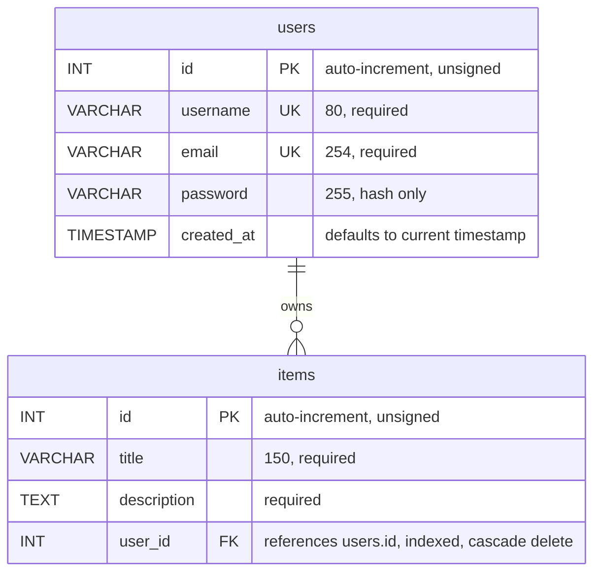

# Northstar Product Requirements Document

**Project:** Northstar account dashboard  
**Course:** Web Technologies (CSF24 Regular)  
**Team:** Junaid Javed (BCSF24M053), Muhammad Kazim (BCSF24M063)  
**Status:** Implemented and locally verified

---

## 1. Executive summary

Northstar is a small, responsive account dashboard. A visitor can register with a
name, email address, and password, sign in, view items associated with the
account, and sign out. It uses PHP for request handling, MySQL for persistent
data, PDO for database access, and PHP sessions for authentication state.

Passwords are hashed, queries use prepared statements, sessions are regenerated at
sign-in, and state-changing forms use CSRF tokens. The dashboard is read-only:
users cannot create, edit, or delete items through the interface.

PHP and JavaScript syntax, page rendering, registration validation, CSRF token
rendering, anonymous-route protection, database-backed registration and login,
and multi-user data isolation are covered by the project's verification suite.
See [verification.md](verification.md) for the current results.

## 2. Introduction and project context

### 2.1 Purpose and product intent

This document records the implemented Northstar application for
software-engineering review. It covers requirements, structure, database design,
security, and verification status. The product gives a registered user a simple
private space for account-linked items; it is intentionally limited to account
access and a read-only dashboard.

### 2.2 Stakeholders

| Role | Interest in the system |
| --- | --- |
| End user | Create an account, return securely, and see their own dashboard items. |
| Project owner | Run the application locally and maintain its code and database. |
| Maintainer | Configure credentials, apply the schema, and diagnose operational errors. |

### 2.3 Working assumptions

- Each item belongs to exactly one user; each user may have zero or more items.
- The dashboard is read-only; item authoring and editing are outside this release.
- MySQL settings come from process environment variables and are not committed to the project.
- The demo user and sample items in the schema are for local development only.
- The supported reference environment is Ubuntu 24.04, Apache 2.4, PHP 8.3, and MySQL 8.0.

## 3. Product requirements

### 3.1 Product goal

Provide a clean, responsive, easy-to-run web application with account
registration, authentication, a protected personal dashboard, and session
sign-out, using MySQL for storage.

### 3.2 Scope

| In scope | Out of scope for this release |
| --- | --- |
| Registration and login by email/password. | Password reset, email verification, or multi-factor authentication. |
| Hashed password storage and session-based authentication. | Role administration or social sign-in. |
| Protected home page with user-specific item listing. | Create, update, delete, search, or share dashboard items. |
| MySQL schema, indexes, foreign key, and local sample data. | Cloud deployment, backups, and production observability. |
| Responsive styling and client-side form feedback. | A full content-management workflow. |

### 3.3 Functional requirements

| ID | Requirement | Acceptance condition |
| --- | --- | --- |
| FR-01 | Registration form | Collect username, email, password, and confirmation; reject invalid or mismatched values. |
| FR-02 | Unique account | Store a new user with a password hash; reject an existing email or username. |
| FR-03 | Login | Authenticate by email and password using the stored password hash. |
| FR-04 | Protected dashboard | Redirect unauthenticated visitors to login; greet the signed-in user. |
| FR-05 | Personal item list | Display only items whose `user_id` matches the signed-in user's ID. |
| FR-06 | Sign out | Accept sign-out as a CSRF-protected POST, destroy the session, and return to login. |
| FR-07 | Error feedback | Show understandable validation and connection errors without exposing database credentials. |

### 3.4 Non-functional requirements

| ID | Category | Requirement |
| --- | --- | --- |
| NFR-01 | Security | Hash passwords; use prepared statements, session controls, output escaping, and CSRF tokens. |
| NFR-02 | Portability | Use PHP and MySQL-compatible SQL and filesystem-safe include paths; avoid embedded credentials. |
| NFR-03 | Usability | Keep registration and sign-in focused, give clear feedback, and support narrow screens. |
| NFR-04 | Maintainability | Separate DB configuration, shared session helpers, page handlers, styles, and scripts. |
| NFR-05 | Reliability | Surface missing configuration and database failures rather than treating them as success. |
| NFR-06 | Compatibility | Target PHP 8.0+ with PDO MySQL and MySQL 5.7+/MariaDB 10.3+. |

### 3.5 Constraints

- The database is `web_project_db`, with `users` and `items` tables.
- No hard-coded DB credentials or OS-specific absolute includes.
- Passwords are checked with `password_verify()`, never compared as plain text.
- A signed-in user must not see another user's records through the dashboard query.
- The local sample account must be removed or replaced before production use.

## 4. User journeys and use cases

### 4.1 Registration

1. The visitor enters a username, email, password, and confirmation.
2. The browser performs basic validation; the server independently validates the values and CSRF token.
3. The server checks for an existing username or email and stores the password using `password_hash()`.
4. On success, the session ID is regenerated, the user's ID and username are stored in the session, and the user is redirected to the dashboard.

### 4.2 Sign-in

1. The user submits an email address and password.
2. The server retrieves the account with a prepared statement and checks the hash with `password_verify()`.
3. On success, the session ID is regenerated and the user is redirected to the dashboard; otherwise a generic authentication error is shown.

### 4.3 Dashboard and sign-out

The dashboard requires both user ID and username in the session, queries only that
user's items, and shows an empty state when there are none. Sign-out is a
CSRF-protected POST that clears the session and cookie and redirects to login.

## 5. System architecture and design

### 5.1 Application layers

| Layer | Responsibility | Project components |
| --- | --- | --- |
| Presentation | Render forms, feedback, dashboard cards, and responsive layout. | `signin.php`, `login.php`, `home.php`, `assets/style.css`, `assets/script.js` |
| Application | Validate requests, manage sessions, authenticate users, and enforce dashboard access. | Page-level PHP handlers; `config/app.php` |
| Data access | Open the PDO connection and issue parameterised SQL. | `config/db.php` and prepared statements |
| Persistence | Store accounts and account-owned items with constraints. | MySQL `web_project_db`; `schema.sql` |

### 5.2 Request flow

A browser submits a form to a PHP page, which loads the shared session helpers,
checks the method, form values, and CSRF token, and calls the PDO layer where
needed. Login and registration regenerate the session ID before redirecting. The
dashboard validates the session before querying items and escapes values when
rendering HTML.

### 5.3 Project structure

```text
northstar/
├── apache/
│   └── northstar.conf          Apache virtual host and access rules
├── assets/
│   ├── script.js               Client-side form validation
│   └── style.css               Responsive interface styling
├── config/
│   ├── app.php                 Shared session, CSRF, and output helpers
│   └── db.php                  PDO connection from environment variables
├── docs/
│   ├── PRD.md                  This document
│   ├── database-setup.md       MySQL setup
│   ├── linux-apache.md         Linux/Apache setup
│   └── verification.md         Verification scope and results
├── scripts/
│   ├── deploy.sh               Apache deployment
│   └── setup-local.sh          Local database and site provisioning
├── tests/
│   ├── bootstrap.php           Test environment loader
│   ├── http.sh                 End-to-end HTTP checks
│   ├── integration.php         Database integration checks
│   ├── run.sh                  Full test entry point
│   └── unit.php                Helper checks
├── home.php                    Protected, read-only dashboard
├── login.php                   Account authentication
├── logout.php                  CSRF-protected session termination
├── schema.sql                  Database, tables, and sample records
└── signin.php                  Account registration
```

## 6. Database design

### 6.1 Entity relationship diagram



A user can own zero or more items. Each item has one required `user_id`
referencing `users.id`, and deleting a user cascades to that user's items.
Primary keys are auto-incrementing unsigned integers, and a foreign-key index
supports account-scoped retrieval.

### 6.2 Data dictionary

| Table | Column | Type | Rules / purpose |
| --- | --- | --- | --- |
| `users` | `id` | `INT UNSIGNED` | Primary key; auto-increment. |
| `users` | `username` | `VARCHAR(80)` | Required; unique account name. |
| `users` | `email` | `VARCHAR(254)` | Required; unique login email. |
| `users` | `password` | `VARCHAR(255)` | Required; stores password hash, not plain text. |
| `users` | `created_at` | `TIMESTAMP` | Required; defaults to current timestamp. |
| `items` | `id` | `INT UNSIGNED` | Primary key; auto-increment. |
| `items` | `title` | `VARCHAR(150)` | Required display title. |
| `items` | `description` | `TEXT` | Required item description. |
| `items` | `user_id` | `INT UNSIGNED` | Required FK to `users.id`; indexed; cascade delete. |

### 6.3 Integrity and query design

- Unique indexes on `users.username` and `users.email` prevent duplicates at the database layer.
- `items.user_id` requires an owning account; `ON DELETE CASCADE` removes dependent items with their user.
- Dashboard retrieval filters on the session's `user_id`, orders by descending item id, and binds all values through PDO prepared statements.
- The application database account is limited to `SELECT` and `INSERT`; it cannot alter schema or delete rows.

### 6.4 Database creation and sample data

`schema.sql` creates `web_project_db` (utf8mb4), both InnoDB tables with their
constraints, and a local demo account with two sample items. Re-importing it does
not duplicate the sample items. The demo credentials are:

- Email: `demo@example.com`
- Password: `DemoPass123!`

## 7. Security and privacy

| Control | Implementation | Operational note |
| --- | --- | --- |
| Password storage | `password_hash()` during registration; `password_verify()` at sign-in. | Never store or log the submitted password. |
| SQL injection prevention | PDO prepared statements; emulated prepares disabled. | Keep user values out of SQL string concatenation. |
| Session fixation | Regenerate the session ID after successful authentication. | Strict session mode rejects uninitialized session IDs. |
| Session cookie | HTTP-only and `SameSite=Lax`; `Secure` enabled under HTTPS. | Use HTTPS in any non-local deployment. |
| CSRF protection | Session token checked on registration, login, and sign-out POSTs. | Continue using POST and the shared token helper for state changes. |
| HTML injection | Escape dynamic output with `htmlspecialchars` via `e()`. | Apply output encoding at the HTML rendering boundary. |
| Browser hardening | `X-Content-Type-Options`, `Referrer-Policy`, `X-Frame-Options`, and `Permissions-Policy` headers. | Apache also applies headers to static assets. |
| Credential handling | Read DB settings from `DB_HOST`, `DB_PORT`, `DB_NAME`, `DB_USER`, `DB_PASSWORD`. | Keep real values out of source control and public web roots. |
| Error handling | Log technical database failures; show a generic retry message. | Review server logs during incident response. |

This release is a local/educational baseline, not a complete production identity
system. It has no rate limiting, account verification, password reset,
multi-factor authentication, or centralised audit monitoring. Production use
should add these, enforce HTTPS, remove the sample account, use least-privilege
database credentials, and configure production-safe PHP error display.

## 8. Interface and user experience

The interface uses a quiet palette, clear typography, and generous spacing.
Registration, sign-in, and the dashboard share one consistent visual language.

- Forms have visible labels, autocomplete hints, and inline browser validation; a small JavaScript check catches empty inputs and mismatched confirmation, and PHP repeats validation on the server.
- The dashboard supports a populated item grid and a deliberate empty state.
- Responsive CSS adapts to narrow screens and respects reduced-motion settings.
- Error notices use accessible alert semantics; the layout remains useful if external fonts fail to load.
- The interface avoids client-side rendering for protected content, so the dashboard remains usable if JavaScript is unavailable.

## 9. Verification

The project includes unit, database integration, and HTTP acceptance tests. The
current results, including the exact environment used, are recorded in
[verification.md](verification.md).

## 10. Deployment and operation

### 10.1 Prerequisites

PHP 8.0+ with PDO MySQL enabled; MySQL 5.7+ or MariaDB 10.3+; Apache 2.4 with
`mod_php` and `mod_headers`. The included provisioning scripts target
Ubuntu/Debian and use the system `sudo` and `mysql` clients.

### 10.2 Setup sequence

1. Place the project under the web server document root, such as `/var/www/northstar`.
2. Start Apache and MySQL.
3. Import `schema.sql` using the MySQL command-line client or phpMyAdmin.
4. Set `DB_HOST`, `DB_PORT`, `DB_NAME`, `DB_USER`, and `DB_PASSWORD` in the PHP/Apache process environment (`DB_NAME` is `web_project_db`).
5. Restart or reload the server process so PHP receives the environment, then open `http://localhost/`.
6. Register an account or use the demo account for local verification; remove or replace it before production.

The `scripts/setup-local.sh` script performs steps 1-5 for a local Ubuntu/Debian
machine. `scripts/deploy.sh` repeats the deployment portion after application
changes.

### 10.3 Configuration and troubleshooting

`config/db.php` validates the database values before connecting and names any
missing variable without exposing secrets. Includes use `__DIR__` with
`DIRECTORY_SEPARATOR`, and links are relative. For Linux PHP-FPM, set the
variables in the pool or deployment environment and restart the service.

| Symptom | Check |
| --- | --- |
| "Database configuration is incomplete" | Define all five `DB_*` variables for the PHP process and reload Apache. |
| Connection failure | Confirm MySQL is running, host/port are correct, the database exists, and the account has access. |
| PDO MySQL driver missing | Enable the `pdo_mysql` extension for the PHP runtime used by Apache. |
| Blank or unstyled page | Confirm `assets/style.css` is reachable and the project is served from the expected document root. |
| 403 for application pages | Confirm the Apache document root and the access rules in `apache/northstar.conf`. |

## 11. Risks, limitations, and next steps

| Area | Current position | Practical next step |
| --- | --- | --- |
| Account protection | No rate limit or account recovery workflow. | Add throttling, password reset, and email verification before public release. |
| Item lifecycle | Dashboard is read-only and uses seeded items. | Add item CRUD only after confirming the workflow and authorisation rules. |
| Production operations | Local run instructions only; no deployment pipeline. | Set HTTPS, least-privilege DB access, backups, error monitoring, and secure PHP settings. |
| Automated regression | Unit, integration, and HTTP tests are included. | Add the suite to a CI workflow and expand it for every new workflow. |
| Demo data | The demo account is seeded by `schema.sql`. | Remove or replace it before production use. |

## 12. Conclusion

Northstar delivers the requested account-and-dashboard workflow with an explicit
MySQL model, core web safeguards, and documented configuration for Linux and
Windows. The local database-backed acceptance checks pass on the reference
environment. Before it is treated as production-ready, the security and
operational enhancements above remain follow-on work.
