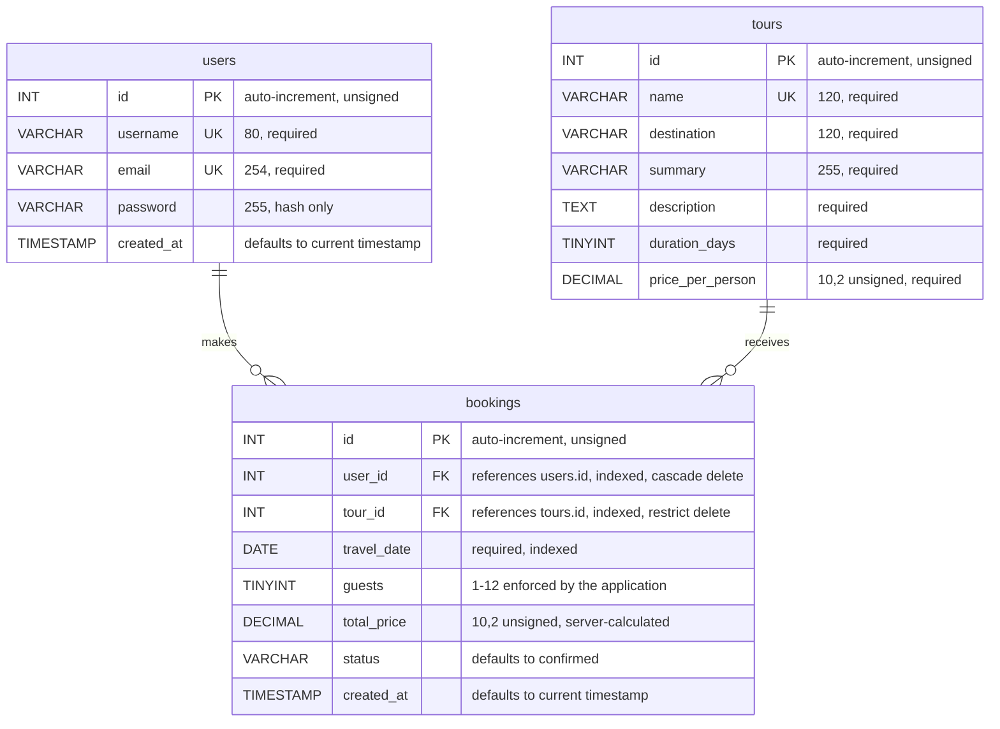

# Northstar Product Requirements Document

**Project:** Northstar tour booking  
**Course:** Web Technologies (CSF24 Regular)  
**Team:** Junaid Javed (BCSF24M053), Muhammad Kazim (BCSF24M063)  
**Status:** Implemented and locally verified

---

## 1. Executive summary

Northstar is a small, responsive tour-booking website. A visitor can browse six
northern Pakistan tours, register with a name, email address, and password, sign
in, reserve a tour for a chosen date and group size, and review their confirmed
bookings on a personal dashboard. It uses PHP for request handling, MySQL for
persistent data, PDO for database access, and PHP sessions for authentication
state.

Passwords are hashed, queries use prepared statements, sessions are regenerated at
sign-in, and state-changing forms use CSRF tokens. Booking totals are recalculated
on the server from the stored tour price, so a forged form value cannot change what
is recorded.

PHP and JavaScript syntax, page rendering, registration validation, CSRF token
rendering, anonymous-route protection, booking validation, account-scoped
booking retrieval, and multi-user isolation are covered by the project's
verification suite. See [verification.md](verification.md) for the current results.

## 2. Introduction and project context

### 2.1 Purpose and product intent

This document records the implemented Northstar application for
software-engineering review. It covers requirements, structure, database design,
security, and verification status. The product gives a registered traveller a
private space to browse tours, reserve a place, and see the bookings attached to
their account.

### 2.2 Stakeholders

| Role | Interest in the system |
| --- | --- |
| Traveller | Browse tours, book a date, and return to see confirmed bookings. |
| Project owner | Run the application locally and maintain its code and database. |
| Maintainer | Configure credentials, apply the schema, and diagnose operational errors. |

### 2.3 Working assumptions

- Each booking belongs to exactly one user and references exactly one tour.
- A user may have zero or more bookings; a tour may have zero or more bookings.
- Tours are curated fixtures in this release; there is no admin authoring interface.
- The booking is a reservation record only: no payment, cancellation, or amendment.
- MySQL settings come from process environment variables and are not committed to the project.
- The demo user, demo booking, and seeded tours are for local development only.
- The supported reference environment is Ubuntu 24.04, Apache 2.4, PHP 8.3, and MySQL 8.0.

## 3. Product requirements

### 3.1 Product goal

Provide a clean, responsive, easy-to-run booking site with a public tour
catalogue, account registration, authentication, a protected booking flow, a
personal bookings dashboard, and session sign-out, using MySQL for storage.

### 3.2 Scope

| In scope | Out of scope for this release |
| --- | --- |
| Public catalogue of curated tours. | Admin tour authoring or inventory management. |
| Registration and login by email/password. | Password reset, email verification, or multi-factor authentication. |
| Hashed password storage and session-based authentication. | Role administration or social sign-in. |
| Booking a tour with travel date and guest count. | Payment processing, cancellation, refunds, or booking changes. |
| Protected dashboard listing only the user's bookings. | Search, filtering, reviews, or sharing. |
| MySQL schema, indexes, foreign keys, and local sample data. | Cloud deployment, backups, and production observability. |
| Responsive styling and client-side form feedback. | Email confirmations or calendar integration. |

### 3.3 Functional requirements

| ID | Requirement | Acceptance condition |
| --- | --- | --- |
| FR-01 | Tour catalogue | Show each tour's name, destination, summary, duration, and per-person price. |
| FR-02 | Registration form | Collect username, email, password, and confirmation; reject invalid or mismatched values. |
| FR-03 | Unique account | Store a new user with a password hash; reject an existing email or username. |
| FR-04 | Login | Authenticate by email and password using the stored password hash. |
| FR-05 | Protected booking | Redirect anonymous visitors to login; accept a tour, travel date, and 1-12 guests. |
| FR-06 | Server-side total | Calculate and store the total from the database price and guest count, ignoring submitted totals. |
| FR-07 | Travel date rules | Accept a real calendar date from today up to two years ahead; reject past, malformed, or impossible dates. |
| FR-08 | Personal bookings | Display only bookings whose `user_id` matches the signed-in user's ID. |
| FR-09 | Confirmation | Redirect after a successful booking and show a confirmation notice on the dashboard. |
| FR-10 | Sign out | Accept sign-out as a CSRF-protected POST, destroy the session, and return to login. |
| FR-11 | Error feedback | Show understandable validation and connection errors without exposing database credentials. |
| FR-12 | Safe return | After sign-in or registration, return to the chosen booking or the dashboard, never to an external URL. |

### 3.4 Non-functional requirements

| ID | Category | Requirement |
| --- | --- | --- |
| NFR-01 | Security | Hash passwords; use prepared statements, session controls, output escaping, and CSRF tokens. |
| NFR-02 | Portability | Use PHP and MySQL-compatible SQL and filesystem-safe include paths; avoid embedded credentials. |
| NFR-03 | Usability | Keep browsing and booking focused, give clear feedback, and support narrow screens. |
| NFR-04 | Maintainability | Separate DB configuration, shared session helpers, page handlers, styles, and scripts. |
| NFR-05 | Reliability | Surface missing configuration and database failures rather than treating them as success. |
| NFR-06 | Compatibility | Target PHP 8.0+ with PDO MySQL and MySQL 5.7+/MariaDB 10.3+. |

### 3.5 Constraints

- The database is `web_project_db`, with `users`, `tours`, and `bookings` tables.
- No hard-coded DB credentials or OS-specific absolute includes.
- Passwords are checked with `password_verify()`, never compared as plain text.
- A signed-in user must not see another user's bookings through the dashboard query.
- The local sample account and demo booking must be removed or replaced before production use.

## 4. User journeys and use cases

### 4.1 Browse and choose a tour

1. The visitor opens `/` and sees the tour catalogue with prices and durations.
2. Selecting **Reserve this tour** opens the booking page. Anonymous visitors are
   redirected to sign-in with the chosen tour preserved in the `next` parameter.

### 4.2 Registration

1. The visitor enters a username, email, password, and confirmation.
2. The browser performs basic validation; the server independently validates the values and CSRF token.
3. The server checks for an existing username or email and stores the password using `password_hash()`.
4. On success, the session ID is regenerated, the user's ID and username are stored in the session, and the user is redirected to the booking page or dashboard.

### 4.3 Sign-in

1. The user submits an email address and password.
2. The server retrieves the account with a prepared statement and checks the hash with `password_verify()`.
3. On success, the session ID is regenerated and the user is returned to the requested local page; otherwise a generic authentication error is shown.

### 4.4 Booking a tour

1. The signed-in user opens `book.php?tour=<id>`.
2. The page shows the tour description, duration, price, and a form for travel date and guests.
3. On submit, the server checks the CSRF token, confirms the tour still exists,
   validates the date and guest count, and recalculates the total from the tour price.
4. The booking is inserted and the user is redirected to `home.php?booked=1`.
5. The dashboard shows the confirmation notice and the new booking.

### 4.5 Dashboard and sign-out

The dashboard requires both user ID and username in the session, queries only that
user's bookings ordered by travel date, and shows an empty state with a catalogue
link when there are none. It also suggests up to three tours the user has not
booked. Sign-out is a CSRF-protected POST that clears the session and cookie and
redirects to login.

## 5. System architecture and design

### 5.1 Application layers

| Layer | Responsibility | Project components |
| --- | --- | --- |
| Presentation | Render the catalogue, forms, booking rows, and responsive layout. | `index.php`, `signin.php`, `login.php`, `book.php`, `home.php`, `assets/style.css`, `assets/script.js` |
| Application | Validate requests, manage sessions, authenticate users, and enforce access. | Page-level PHP handlers; `config/app.php` |
| Data access | Open the PDO connection and issue parameterised SQL. | `config/db.php` and prepared statements |
| Persistence | Store accounts, tours, and bookings with constraints. | MySQL `web_project_db`; `schema.sql` |

### 5.2 Request flow

A browser requests a PHP page, which loads the shared session helpers, checks the
method, form values, and CSRF token, and calls the PDO layer where needed. Login
and registration regenerate the session ID before redirecting. Protected pages
validate the session before querying data, and all values are escaped when
rendered into HTML. Booking totals are derived on the server.

### 5.3 Project structure

```text
northstar/
├── apache/
│   └── northstar.conf          Apache virtual host and access rules
├── assets/
│   ├── script.js               Client-side validation and live total
│   └── style.css               Responsive interface styling
├── config/
│   ├── app.php                 Session, CSRF, escaping, and shared helpers
│   └── db.php                  PDO connection from environment variables
├── docs/
│   ├── PRD.md                  This document
│   ├── database-setup.md       MySQL setup
│   ├── linux-apache.md         Linux/Apache setup
│   └── verification.md         Verification scope and results
├── scripts/
│   ├── deploy.sh               Apache deployment
│   └── setup-local.sh          Local database and site provisioning
├── tests/
│   ├── bootstrap.php           Test environment loader
│   ├── http.sh                 End-to-end HTTP checks
│   ├── integration.php         Database integration checks
│   ├── run.sh                  Full test entry point
│   └── unit.php                Helper checks
├── book.php                    Protected booking form
├── home.php                    Protected bookings dashboard
├── index.php                   Public tour catalogue
├── login.php                   Account authentication
├── logout.php                  CSRF-protected session termination
├── schema.sql                  Database, tables, tours, and sample records
└── signin.php                  Account registration
```

## 6. Database design

### 6.1 Entity relationship diagram



A user makes zero or more bookings; a tour receives zero or more bookings. Each
booking has one required `user_id` and one required `tour_id`. Deleting a user
cascades to that user's bookings; a tour with bookings cannot be deleted because
the foreign key uses `ON DELETE RESTRICT`. Primary keys are auto-incrementing
unsigned integers, and indexes support account-scoped retrieval and date ordering.

### 6.2 Data dictionary

| Table | Column | Type | Rules / purpose |
| --- | --- | --- | --- |
| `users` | `id` | `INT UNSIGNED` | Primary key; auto-increment. |
| `users` | `username` | `VARCHAR(80)` | Required; unique account name. |
| `users` | `email` | `VARCHAR(254)` | Required; unique login email. |
| `users` | `password` | `VARCHAR(255)` | Required; stores password hash, not plain text. |
| `users` | `created_at` | `TIMESTAMP` | Required; defaults to current timestamp. |
| `tours` | `id` | `INT UNSIGNED` | Primary key; auto-increment. |
| `tours` | `name` | `VARCHAR(120)` | Required; unique tour name. |
| `tours` | `destination` | `VARCHAR(120)` | Required; display location. |
| `tours` | `summary` | `VARCHAR(255)` | Required; short card copy. |
| `tours` | `description` | `TEXT` | Required; long description on the booking page. |
| `tours` | `duration_days` | `TINYINT UNSIGNED` | Required; trip length in days. |
| `tours` | `price_per_person` | `DECIMAL(10,2) UNSIGNED` | Required; price used for the booking total. |
| `bookings` | `id` | `INT UNSIGNED` | Primary key; auto-increment. |
| `bookings` | `user_id` | `INT UNSIGNED` | Required FK to `users.id`; indexed; cascade delete. |
| `bookings` | `tour_id` | `INT UNSIGNED` | Required FK to `tours.id`; indexed; restrict delete. |
| `bookings` | `travel_date` | `DATE` | Required; validated from today to two years ahead. |
| `bookings` | `guests` | `TINYINT UNSIGNED` | Required; application accepts 1-12. |
| `bookings` | `total_price` | `DECIMAL(10,2) UNSIGNED` | Required; calculated as price x guests. |
| `bookings` | `status` | `VARCHAR(20)` | Required; defaults to `confirmed`. |
| `bookings` | `created_at` | `TIMESTAMP` | Required; defaults to current timestamp. |

### 6.3 Integrity and query design

- Unique indexes on `users.username`, `users.email`, and `tours.name` prevent duplicates at the database layer.
- `bookings.user_id` requires an owning account; `ON DELETE CASCADE` removes dependent bookings with their user.
- `bookings.tour_id` requires a real tour; `ON DELETE RESTRICT` protects booking history.
- Dashboard retrieval filters on the session's `user_id`, orders by ascending travel date, and binds all values through PDO prepared statements.
- The booking total is computed in PHP from the stored price and validated guest count, then inserted as a bound value.
- The application database account is limited to `SELECT` and `INSERT`; it cannot alter schema or delete rows.

### 6.4 Database creation and sample data

`schema.sql` creates `web_project_db` (utf8mb4), the three InnoDB tables with
their constraints, six seeded tours, a local demo account, and one upcoming demo
booking. Re-importing it does not duplicate the tours, the account, or the demo
booking. The demo credentials are:

- Email: `demo@example.com`
- Password: `DemoPass123!`

## 7. Security and privacy

| Control | Implementation | Operational note |
| --- | --- | --- |
| Password storage | `password_hash()` during registration; `password_verify()` at sign-in. | Never store or log the submitted password. |
| SQL injection prevention | PDO prepared statements; emulated prepares disabled. | Keep user values out of SQL string concatenation. |
| Session fixation | Regenerate the session ID after successful authentication. | Strict session mode rejects uninitialized session IDs. |
| Session cookie | HTTP-only and `SameSite=Lax`; `Secure` enabled under HTTPS. | Use HTTPS in any non-local deployment. |
| CSRF protection | Session token checked on registration, login, booking, and sign-out POSTs. | Continue using POST and the shared token helper for state changes. |
| HTML injection | Escape dynamic output with `htmlspecialchars` via `e()`. | Apply output encoding at the HTML rendering boundary. |
| Price tampering | Recalculate the booking total from the database price. | Never trust a submitted total or price. |
| Open redirects | Accept only `book.php` and `home.php` as post-login destinations. | Keep the allow-list when adding new redirects. |
| Browser hardening | `X-Content-Type-Options`, `Referrer-Policy`, `X-Frame-Options`, and `Permissions-Policy` headers. | Apache also applies headers to static assets. |
| Credential handling | Read DB settings from `DB_HOST`, `DB_PORT`, `DB_NAME`, `DB_USER`, `DB_PASSWORD`. | Keep real values out of source control and public web roots. |
| Error handling | Log technical database failures; show a generic retry message. | Review server logs during incident response. |

This release is a local/educational baseline, not a complete production booking
system. It has no rate limiting, account verification, password reset,
multi-factor authentication, payment handling, or centralised audit monitoring.
Production use should add these, enforce HTTPS, remove the sample account, use
least-privilege database credentials, and configure production-safe PHP error
display.

## 8. Interface and user experience

The interface uses a quiet palette, clear typography, and generous spacing.
The catalogue, authentication pages, booking form, and dashboard share one
consistent visual language.

- The catalogue presents tours as cards with destination, duration, and price.
- Forms have visible labels, autocomplete hints, and inline browser validation; a small JavaScript check catches empty inputs and mismatched confirmation, and PHP repeats validation on the server.
- The booking form updates the estimated total as the guest count changes.
- The dashboard supports a populated bookings list and a deliberate empty state.
- Responsive CSS adapts to narrow screens and respects reduced-motion settings.
- Error and confirmation notices use accessible alert/status semantics.
- The interface avoids client-side rendering for protected content, so the booking flow remains usable if JavaScript is unavailable.

## 9. Verification

The project includes unit, database integration, and HTTP acceptance tests. The
current results, including the exact environment used, are recorded in
[verification.md](verification.md).

## 10. Deployment and operation

### 10.1 Prerequisites

PHP 8.0+ with PDO MySQL enabled; MySQL 5.7+ or MariaDB 10.3+; Apache 2.4 with
`mod_php` and `mod_headers`. The included provisioning scripts target
Ubuntu/Debian and use the system `sudo` and `mysql` clients.

### 10.2 Setup sequence

1. Place the project under the web server document root, such as `/var/www/northstar`.
2. Start Apache and MySQL.
3. Import `schema.sql` using the MySQL command-line client or phpMyAdmin.
4. Set `DB_HOST`, `DB_PORT`, `DB_NAME`, `DB_USER`, and `DB_PASSWORD` in the PHP/Apache process environment (`DB_NAME` is `web_project_db`).
5. Restart or reload the server process so PHP receives the environment, then open `http://localhost/`.
6. Register an account or use the demo account for local verification; remove or replace it before production.

The `scripts/setup-local.sh` script performs steps 1-5 for a local Ubuntu/Debian
machine. `scripts/deploy.sh` repeats the deployment portion after application
changes.

### 10.3 Configuration and troubleshooting

`config/db.php` validates the database values before connecting and names any
missing variable without exposing secrets. Includes use `__DIR__` with
`DIRECTORY_SEPARATOR`, and links are relative. For Linux PHP-FPM, set the
variables in the pool or deployment environment and restart the service.

| Symptom | Check |
| --- | --- |
| "Database configuration is incomplete" | Define all five `DB_*` variables for the PHP process and reload Apache. |
| Connection failure | Confirm MySQL is running, host/port are correct, the database exists, and the account has access. |
| PDO MySQL driver missing | Enable the `pdo_mysql` extension for the PHP runtime used by Apache. |
| Blank or unstyled page | Confirm `assets/style.css` is reachable and the project is served from the expected document root. |
| 403 for application pages | Confirm the Apache document root and the access rules in `apache/northstar.conf`. |
| Booking form rejects a date | Dates must be real calendar dates from today to two years ahead. |
| No tours on the catalogue | Import `schema.sql` and confirm the `tours` table contains rows. |

## 11. Risks, limitations, and next steps

| Area | Current position | Practical next step |
| --- | --- | --- |
| Account protection | No rate limit or account recovery workflow. | Add throttling, password reset, and email verification before public release. |
| Booking lifecycle | Bookings are created and listed; no payment or cancellation. | Add payment, cancellation rules, and an audit trail. |
| Tour management | Tours are seeded by `schema.sql`. | Add a protected admin interface with validation and image handling. |
| Production operations | Local run instructions only; no deployment pipeline. | Set HTTPS, least-privilege DB access, backups, error monitoring, and secure PHP settings. |
| Automated regression | Unit, integration, and HTTP tests are included. | Add the suite to a CI workflow and expand it for every new workflow. |
| Demo data | The demo account and booking are seeded by `schema.sql`. | Remove or replace them before production use. |

## 12. Conclusion

Northstar delivers a complete browse-register-book-review workflow with an
explicit MySQL model, server-side price and date validation, core web safeguards,
and documented configuration for Linux and Windows. The local database-backed
acceptance checks pass on the reference environment. Before it is treated as
production-ready, the payment, security, and operational enhancements above
remain follow-on work.
